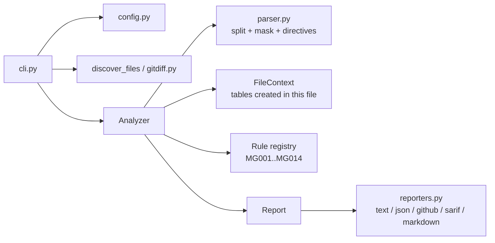

# MigrationGuard: low-level design

## Problem

Schema migrations are reviewed as ordinary code, but their failure modes are
operational and invisible in a diff. `ALTER TABLE orders ALTER COLUMN amount TYPE
NUMERIC` reads like a one-line change. On a large table it rewrites every row while
holding an `ACCESS EXCLUSIVE` lock, and every query against `orders` waits until it
finishes. Reviewers miss these problems because spotting them takes database
internals knowledge that most product engineers don't have.

**Goal:** a check that runs in every PR and on developer machines. It flags risky
migration statements with a concrete explanation and a safe alternative. It must be
fast, deterministic, and need no database connection.

**Non-goals:** executing migrations, connecting to a live database, or rewriting SQL
automatically.

## Requirements

| # | Requirement | How it is met |
|---|---|---|
| R1 | No false positives from strings or comments | Lexer masks string literals and strips comments before matching |
| R2 | Only check the PR's migrations, not history | `--changed-since <ref>` uses `git diff base...HEAD` |
| R3 | Results show up where engineers look | GitHub annotations, job summary, SARIF, JSON, text |
| R4 | Teams can tune behaviour without forking | TOML config (`disable`, `[severity]`, `fail_on`, globs) and inline `ignore` directives |
| R5 | Adding a rule shouldn't touch the engine | Rule registry plus Strategy/Template Method classes |
| R6 | Reproducible CI results | Pure static analysis: same input, same output, no network |
| R7 | Each failure gets its own exit code | 0 OK, 1 blocking findings, 2 usage/config/parse errors |

## Architecture

### Parser (`parser.py`)

The parser is a single-pass, character-level lexer, O(n) in file size. It tracks:
- single-quoted strings (with `''` escapes) → replaced by `'?'` in the normalized text
- double-quoted identifiers → kept, because rules need table names
- `--` and `/* */` comments → removed, but scanned for `migration-guard:` directives
- PostgreSQL dollar quotes (`$$`, `$tag$`) → masked, so function bodies never split statements
- line numbers, so findings point at the exact line

Each directive is bound to a statement when the lexer reads it. A directive on its
own line applies to the next statement. A directive that trails code applies to the
statement it follows. Unterminated tokens raise `SqlParseError`. That error is
reported as a file error with exit code 2, so an unparsed file never passes silently.

### Rules (`rules/`)

- `Rule` (ABC): `id`, `name`, `severity`, `summary`, optional `dialects`, `check(stmt, ctx)`.
- `AlterTableRule` (Template Method): parses `ALTER TABLE <t> a1, a2, ...` once,
  splits actions on top-level commas (so `NUMERIC(10,2)` stays whole), and calls
  `check_action` for each action.
- `@register` puts each class in a registry keyed by rule id and rejects duplicate ids.
- `FileContext.created_tables`: tables created earlier in the same file are empty.
  Index builds, NOT NULL columns and constraints on them are safe, so most rules skip
  them. This is the main defence against false positives on "create table" migrations.

### Reporters (`reporters.py`)

Each reporter is a plain function `Report -> str` in a dict, so adding a format takes
one function. The JSON schema is stable and is the integration point for scripts and
other tools.

## Trade-offs

- **Regex rules on normalized SQL instead of a full SQL grammar.** Migrations use a
  small DDL subset, and a full parser for every dialect is a large dependency that
  still trails new syntax. Masking strings and comments removes the main source of
  regex false positives. The cost is that statements inside `DO $$ ... $$` blocks
  are not analysed.
- **Static analysis instead of a shadow database.** Static checks are instant and need
  no infrastructure, but they don't know table sizes. Severity is therefore tunable
  per repository.
- **Per-file context only.** A table created in migration 0007 and indexed in 0008 is
  still flagged in 0008. That is correct once 0007 has shipped.

## Testing

- 96 pytest tests, 97% branch coverage, with a 90% gate in CI.
- Parametrized positive and negative cases for every rule.
- CLI tests run against a real temporary git repository to cover `--changed-since`.
- CI runs lint and tests on Python 3.10–3.13, runs the tool on the example
  migrations, and builds the Docker image.
